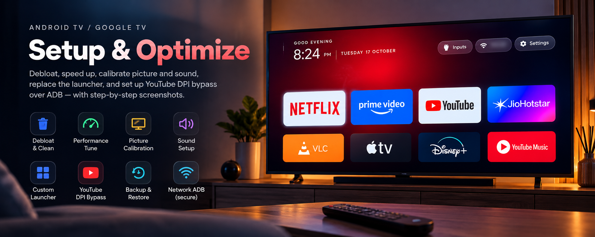

<p align="center">
  
</p>

<h1 align="center">CleanTV</h1>

<p align="center"><b>English</b> · <a href="README.uk.md">Українська</a> · <a href="README.ru.md">Русский</a></p>

<p align="center">
  <b>Remove ads from your Google TV home screen and make the TV fast again with one sentence in Claude Code.</b><br>
  The skill debloats the TV over ADB without root, calibrates picture and sound, and swaps the ad-filled home screen for a clean Android TV launcher with your own apps.
</p>

<p align="center">
  <a href="https://github.com/JohnWayneeee/cleantv/stargazers"></a>
  
  
  
</p>

<p align="center">
  <b>For you if</b> you own an Android TV or Google TV set or box and its home screen sells you films instead of opening your apps.<br>
  Xiaomi, TCL, Hisense, Sony, Philips, CHiQ/Changhong, Haier, Harper, Nvidia Shield and others. Not for Samsung Tizen, LG webOS or Fire TV.
</p>

<p align="center">
  <a href="#three-steps"></a>
</p>

---

## Before → after

You turn the TV on to watch one thing. First comes a row of ads and "recommended for you". The menu lags a second
behind the remote. Apps open slowly. The fixes you find online are forum threads with a list of
`adb` commands and no way back if one of them kills Wi-Fi.

The cause is the same on most sets. Out of the box the TV runs a dozen vendor services, telemetry and ad rows in
the background, and smooths and sharpens films. On our CHiQ the stock equaliser added +41 at 5 kHz. All of that
shares 1–3 GB of RAM with your apps.

Measured on two TVs:

| | Out of the box | After CleanTV |
|---|---|---|
| Free memory (CHiQ, 2.8 GB) | 1.42 GB | **1.77 GB** |
| Free memory (Harper, 1.8 GB) | 721 MB | **888 MB** |
| Home screen | ads and recommendations | **your apps on pitch black** |
| Picture | factory preset and "enhancers" | **calibrated for your room** |
| YouTube where the ISP throttles it | stalls | **plays, bypass for YouTube only** |
| What you watch | recognised on screen, sold for ads | **recognition off, mic and camera locked** |

### Your TV is watching you back

Most smart TVs run ACR, automatic content recognition. The TV samples what is on screen several times a second,
films from an HDMI box or a console included, matches it against a database and sends the result for ad targeting.
A 2024 UC Davis / UCL study measured Samsung sampling every 500 ms and LG every 10 ms. On Android TV and Google TV
it is usually Samba TV (Sony, TCL, Philips and others) or a vendor service. Vendor apps can also hold the
microphone and the camera.

That is why TVs keep getting cheaper: the money is in the viewing data. Vizio reports more profit from ads and
viewer data than from the TVs themselves, and paid the FTC $2.2M in 2017 for tracking 11 million sets without
consent. In December 2025 Texas sued Samsung, Sony, LG, Hisense and TCL over ACR.

The switch is buried in the menus, and a switch is only a promise. CleanTV turns it off with you, then checks for
itself: it disables the ACR and ad packages and blocks the microphone and the camera for every app you don't use
them with.

## What it does

- **Debloat.** Disables telemetry, ads and vendor junk. Asks what you use first. Removes nothing: one command brings everything back.
- **Privacy, on every TV.** Finds ACR, viewing-data and ad services and disables them. Walks you through the
  "viewing information", diagnostics and ad ID switches and checks each one on a screenshot. Takes the microphone and
  the camera away from vendor apps; your voice assistant keeps the mic if you use it. Turns on a DNS filter that
  blocks the tracking hosts the TV calls even with the switches off, and proves it works.
- **Speed.** Measures memory before and after. Speeds up animations, limits background work of rarely used apps.
- **Apple TV style launcher.** Pitch black background, a dock with your apps, a glass highlight, a clock, an HDMI inputs menu. On power-on it shows placeholder tiles at once instead of a black screen.
- **Calibrated picture.** Mode, colour temperature, gamma and backlight for your room's light. Switches off motion smoothing, noise reduction and the other "enhancers".
- **Sound.** Dolby, dialogue enhancement, volume levelling, night mode. For TV speakers, a soundbar, optical or Bluetooth.
- **YouTube without throttling.** Installs [ByeByeDPI](https://github.com/romanvht/ByeByeDPI) on the TV itself, no external servers. Only YouTube goes through it. The launcher starts it when YouTube opens and stops it on the home screen.
- **Checks on the TV.** The skill confirms each step with a screenshot from the TV or a command. At the end it closes network debugging and proves the port is shut.

| You | Claude |
|---|---|
| Turn on debugging on the TV | Finds the TV on your network |
| Say "Set up my TV" | Picks the packages and runs every `adb` command |
| Answer 10–15 questions about how you use the TV | Checks each step on screen and logs it, so one command undoes it all |

## Ways to remove ads from Google TV

| | Apps-only mode | Launcher app | Ad-blocking DNS | **CleanTV** |
|---|:-:|:-:|:-:|:-:|
| No ads on the home screen | ➖ fewer | ✅ | ➖ some | ✅ |
| Screen recognition (ACR) off, mic and camera locked | ❌ | ❌ | ➖ some hosts | ✅ |
| Vendor services off, memory freed | ❌ | ❌ | ❌ | ✅ |
| Picture and sound calibrated | ❌ | ❌ | ❌ | ✅ |
| No YouTube ads | ❌ | ❌ | ❌ | ❌ |
| Undo | toggle | uninstall | setting | one command |

On Google TV a third-party launcher cannot win the Home button while the stock launcher is enabled: the system
caps its priority. CleanTV disables the stock launcher and the setup wizard in the right order and keeps Wi-Fi alive
([`references/launcher.md`](skills/android-tv-setup/references/launcher.md)).

Prefer to do it by hand? The full command list with an undo for every step: [How to Remove Ads from Google TV (and Make It Faster)](https://medium.com/@ghost.waynee/how-to-remove-ads-from-google-tv-and-make-it-faster-a-free-adb-guide-02dba456c6ce).

## Three steps

**1. Install the skill.** The easiest way: copy this prompt and send it to Claude Code. The agent installs everything.

```text
Install the CleanTV skill for Claude Code from https://github.com/JohnWayneeee/cleantv
1. Clone the repository into a temporary folder: git clone --depth 1 https://github.com/JohnWayneeee/cleantv
2. Copy skills/android-tv-setup to ~/.claude/skills/android-tv-setup
   (on Windows: %USERPROFILE%\.claude\skills\android-tv-setup). If the folder exists, ask me before replacing it.
3. Check that adb (Android SDK platform-tools) and Python 3 are installed. The launcher also needs
   JDK 17+ and Android SDK platform 35. If something is missing, tell me how to install it on my OS
   and install it only after I agree.
4. Delete the temporary folder.
5. Show me that ~/.claude/skills/android-tv-setup/SKILL.md exists and remind me
   to restart Claude Code and say "Set up my TV".
```

Or with Claude Code plugins:

```text
/plugin marketplace add JohnWayneeee/cleantv
/plugin install android-tv-setup@android-tv-setup
```

**2. Turn on debugging on the TV.** Settings → Device Preferences → About → press OK on "Build" 7 times.
Back → Developer options → turn on "USB debugging" and "Network debugging" (if listed).

**3. Tell Claude:** "Set up my TV".

The skill finds the TV on your network and asks 10–15 questions along the way: which services to keep, how bright
the room is, what bothers you in the sound. All questions: [`references/questions.md`](skills/android-tv-setup/references/questions.md).

<details>
<summary>What you need on the computer</summary>

- Android SDK platform-tools (`adb`);
- Python 3;
- for the launcher: Android SDK platform 35 and JDK 17+ (the JDK bundled with Android Studio works).

The TV and the computer must be on the same network. If the computer runs a VPN, exclude your home subnet from the tunnel.
</details>

## Safety

- The skill disables system packages (`pm disable-user`) and does not uninstall them.
- It leaves alone what the TV needs to show a picture, switch inputs or pair the remote.
- It backs up the TV before the first change. Each TV's data stays in `tvs/<model>/`, outside git.
- Undo everything with one command:

```sh
cd tvs/<model>
python ../../skills/android-tv-setup/scripts/restore.py
```

## FAQ

**Can I remove ads from Google TV without root?**
Yes. CleanTV works over ADB debugging, which you turn on in Developer options. No root, no unlocked bootloader.

**Does the TV really watch what I watch?**
If ACR is on, yes: it recognises the picture, also from HDMI, and reports it. CleanTV disables those services,
has you switch off the menu toggles, and blocks the microphone and the camera for apps that don't need them.

**I have a Samsung or LG. Can I at least turn the tracking off?**
CleanTV does not work on Tizen or webOS, but the switches are in the menu. Samsung: Settings → Support → Terms &
Privacy → Viewing Information Services off, and Interest-Based Advertisement off. LG: Settings → General → System →
Additional Settings → Live Plus off, and in User Agreements untick Viewing Information and Interest-Based
Recommendation. Paths change by model year.

**Will it break my TV?**
Packages are disabled, not uninstalled. The skill refuses Android core, factory and Wi-Fi owner packages, backs up
first and checks each step with a screenshot. `restore.py` brings everything back.

**Does it block YouTube ads?**
No. It removes ads from the home screen and vendor services. YouTube ads are served by YouTube itself.

**Which Android version does the launcher need?**
Android 8.0 or newer. On older TVs the skill does the debloat and leaves the stock launcher.

**Does it work on Fire TV, Samsung or LG?**
No. Fire OS refuses `pm disable-user`, and Tizen and webOS are not Android.

## Next

- Remote module: app buttons, the gear key, remapping, Bluetooth remotes.
- Picture and sound settings tables for popular boards: [`references/devices/`](skills/android-tv-setup/references/devices/). Tuned your TV? Send a PR with notes on its board.

---

## Support the project

CleanTV is free and MIT licensed. Every board breaks in its own way, so each feature is tested on real TVs before
it ships. Two ways to help:

- ⭐ **Star the repo.** It takes a second and helps other owners of sluggish TVs find it.
- ☕ **Buy me a coffee.** If CleanTV saved you an evening of `adb` commands, a coffee pays for the next module:
  remote buttons, app keys and Bluetooth remotes.

<p align="center">
  <a href="https://www.buymeacoffee.com/JohnWayne"></a>
  <br><br>
  
</p>

## License

MIT. Onest font: SIL Open Font License 1.1.
